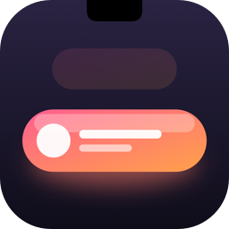
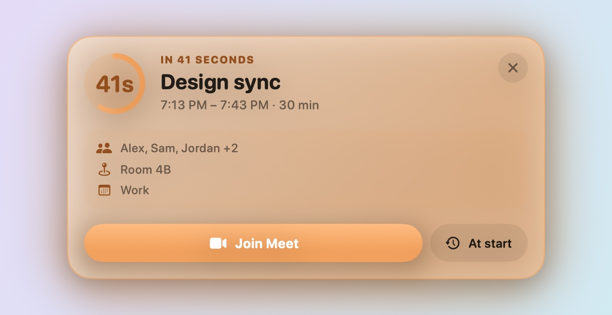
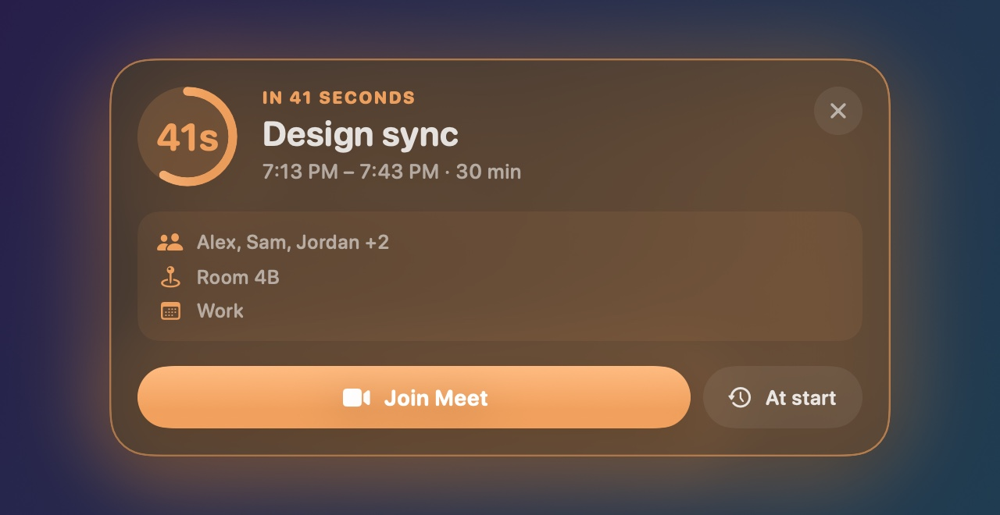
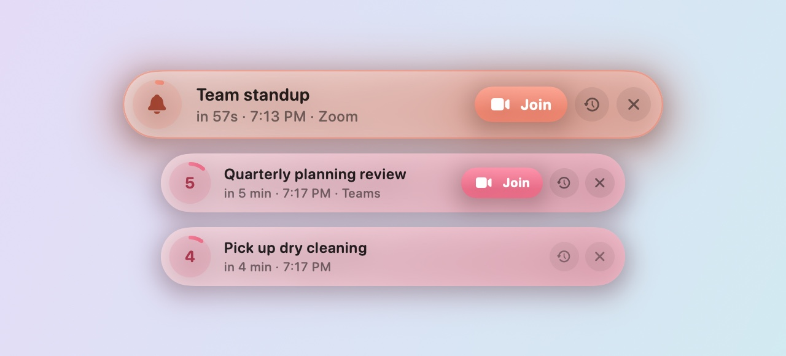
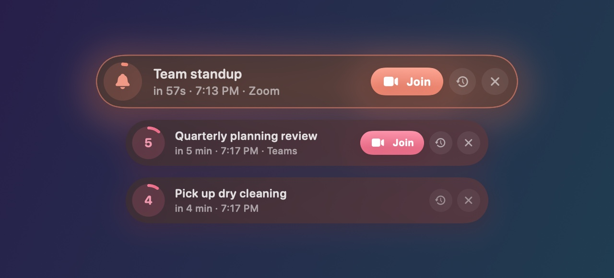

> [!NOTE]
> This is the **beta** track, at 0.3.0-beta.5. For the stable release, see [main](https://github.com/schultzisaiah/psst-macos).

  

<h1 align="center">Psst</h1>

Meeting reminders for macOS that are hard to miss and nice to look at.

  <a href="https://github.com/schultzisaiah/psst-macos/releases/latest"><b>Download for Mac</b></a>

  
  

Psst lives in your menu bar and reads the calendars already on your Mac. Before each meeting, a glossy pill drops out from under the notch, counts down, and puts the call one click away. When the meeting starts, the alert can move to the center of the screen and the screen's edges glow in the calendar's color.

## Alerts

  
  

- **One-click Join** for Zoom, Google Meet, Teams, Webex, Whereby, Around, Chime, GoTo, and Slack huddles.
- **A countdown ring** that fills until the meeting starts.
- **Large cards** with who's invited, the room, and full-width Join and Snooze buttons.
- **Swipe like a notification**: two fingers right to dismiss, left to snooze.
- **Every display** gets the alert, so a meeting can't sneak up while you're looking at the other monitor.
- **As many reminders as you like**, each with its own size, position, color, sound, and screen glow.

## Menu bar timer

  
  

In a meeting, the menu bar shows its title and the time left over a bar that fills as it goes. Between meetings, it counts down to the next one. Click it for today's schedule and a Join button. Hide a meeting that's been called off, or right-click one to always hide meetings with that name.

## Focus and privacy

- Works with **Focus**: show alerts as usual, quietly, or not until the Focus ends.
- Alerts **wait out a locked screen** and stay **out of screen shares and recordings**.
- Psst uses the calendar accounts already set up on your Mac (iCloud, Google, Exchange, and others). Your calendar never leaves your Mac. The only thing Psst fetches is its update feed from this repository.

## Install

1. Download `Psst-x.y.z.dmg` from [Releases](https://github.com/schultzisaiah/psst-macos/releases/latest).
2. Open it and drag Psst to Applications.
3. Open Psst and allow calendar access.

Psst is signed and notarized by Apple. It needs macOS 14 or later and runs on Apple silicon and Intel Macs.

## Updates

Psst updates itself. In **Settings → General → Updates**, choose **Stable**, or **Beta** to also get pre-releases and try new things early.
